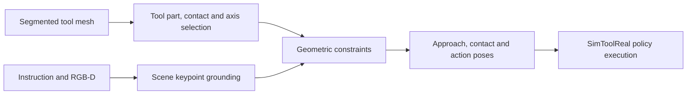

# Tool-Frame

Tool-Frame is a research implementation of image-grounded tool manipulation.
It connects a language instruction, a segmented tool mesh, and calibrated
RGB-D observations to a sequence of whole-tool SE(3) goals, then executes
those goals with a pretrained [SimToolReal](https://github.com/tylerlum/simtoolreal)
policy.

The repository includes eight prepared tools and nine simulation scenes with
paired RGB-D observations and fixed keypoint annotations,
covering striking, sweeping, insertion, and tabletop/whiteboard motions.
All examples use the same planning entry point and shared settings.

## Method



- **Tool geometry:** part graphs, contact candidates, and tool-local motion axes
  derived from mesh face labels; two-stage VLM selection chooses the working
  part and its contact/axis references.
- **Scene grounding:** image keypoints are lifted through calibrated depth or
  camera-ray intersection with a declared interaction plane.
- **Pose compilation:** geometric constraints produce approach, contact, and
  action stages, with path subdivision and support-surface checks.
- **Execution:** the fixed-goal controller uses the pretrained SimToolReal
  policy, including its observation and action conventions.

See [architecture](docs/architecture.md) for the implementation map and
[usage](docs/usage.md) for inputs and extension points.

## Quick start: CPU planning

Use Python 3.8. This example needs neither a GPU nor a VLM API key.

```bash
git clone https://github.com/BIGBIGDANG/Tool-Frame.git
cd Tool-Frame
python3.8 -m venv .venv
source .venv/bin/activate
python -m pip install -r requirements.txt

python run.py plan \
  --task examples/mallet_hammer_strike.json \
  --scene-evidence examples/observations/mallet_hammer_strike/scene_evidence.json \
  --scene-keypoints examples/observations/mallet_hammer_strike/scene_keypoints.json \
  --tool-refs assets/tool_refs/mallet_hammer.json \
  --output outputs/mallet_plan
```

The command produces `constraint_program.json`, `tool_pose_subgoals.json`,
and `fixed_goals.json`. The included keypoints are manual annotations of the
included RGB-D image; they provide a reproducible planning input.
Inputs and a command to compile all nine scenes are in
[example observations](examples/observations/README.md).

## GPU execution and online grounding

Simulation uses the **IsaacGym / Python 3.8** runtime, a compatible NVIDIA GPU,
and the official SimToolReal pretrained weights. SDKs and weights are downloaded
separately. Follow [runtime setup and reproduction](docs/reproducibility.md).

Once configured, render a scene, select tool references, ground keypoints,
compile poses, and execute:

```bash
export VLM_MODEL=your-image-capable-model
export OPENAI_API_KEY=your-api-key
python run.py run \
  --task examples/mallet_hammer_strike.json \
  --output outputs/mallet_online \
  --device cuda:0
```

The model must support image input and JSON output. `VLM_API_BASE` configures
a compatible endpoint; `VLM_API_KEY` is also accepted. Cached inputs allow
planning and execution without online model calls.

## Validation status

This is a research preview. Software regression has **107 passing tests**.
With fixed grounding inputs, all nine scenes compile and start the policy;
seven control sequences completed and two timed out in the recorded run.
These are controller results, not task-success rates. Online VLM behavior and
P3SAM segmentation of new meshes have not been validated in this release.
See [validation results and limitations](docs/validation/README.md).

## Documentation

- [Runtime setup and reproduction](docs/reproducibility.md)
- [Commands, input formats, and new tools](docs/usage.md)
- [Architecture](docs/architecture.md)
- [Validation results](docs/validation/README.md)
- [Contributing](CONTRIBUTING.md)

## Acknowledgements and licensing

Tool-Frame builds on SimToolReal, IsaacGymEnvs, rl_games, and P3SAM-derived
tool segmentation labels. See [third-party sources](THIRD_PARTY.md).
A project-level open-source license has not yet been selected; third-party
licenses and unresolved asset attribution are documented in [LICENSES.md](LICENSES.md).
